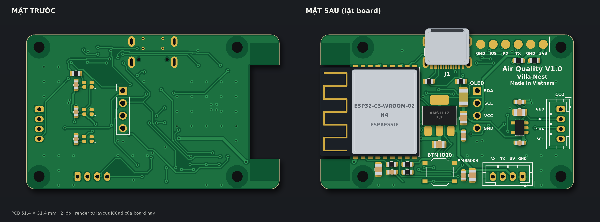

# C3-WROOM Air Quality

Thiết bị đo chất lượng không khí dùng **ESP32-C3-WROOM-02**: bụi mịn PM1.0/PM2.5/PM10 (Plantower **PMS5003**), CO2/nhiệt độ/độ ẩm (Sensirion **SCD40**), màn hình **OLED 1.3" SH1106** và 3 LED RGB địa chỉ hóa báo trạng thái.

Repo gồm **phần cứng** (KiCad, file sản xuất JLCPCB) và **firmware** (đang phát triển).



## Cấu trúc thư mục

```
.
├── hardware/                 Thiết kế phần cứng
│   ├── kicad/
│   │   ├── main/             Bản chính: 3 LED XL-1615, JLC lắp 2 mặt
│   │   ├── led2020/          Bản thử nghiệm: JLC lắp 1 mặt, tự hàn 3 LED WS2812B-2020
│   │   └── lib/              Thư viện ký hiệu + footprint dùng chung (PM25)
│   ├── production/<bản>/     File đặt JLCPCB: gerber, BOM, CPL
│   ├── docs/<bản>/           Sơ đồ nguyên lý PDF, layout PDF, BOM đầy đủ, tọa độ đầy đủ
│   ├── mechanical/           Đường viền board (DXF) để thiết kế vỏ
│   └── cost/                 Kho giá linh kiện + BOQ giá thành 1 sản phẩm
├── firmware/                 Firmware ESP32-C3 (chưa có code)
│   └── include/board_pins.h  Gán chân GPIO dùng chung cho mọi framework
└── docs/                     Tài liệu: gán chân, đặt hàng JLC, hàn LED, sửa lỗi, lịch sử
```

## Thông số board

| Mục | Giá trị |
|---|---|
| Kích thước | 51,4 × 31,4 mm, 2 lớp, dày 1,6 mm, bo góc R1,7 |
| Anten | Khoét 6 × 19 mm ở cạnh phải, không đổ đồng vùng anten |
| Nguồn | USB-C chỉ cấp nguồn (5 V), cổng lồi khỏi mép board 1,2 mm |
| Ổn áp | AMS1117-3.3 cho ESP32 + OLED; AP2112K-3.3 riêng cho SCD40 |
| Nạp firmware | 6 pad tròn J5 (UART0 + IO9), xem [docs/pinout.md](docs/pinout.md) |
| Nút | SW2 TS-1187A nối IO10 (nút người dùng) |

## Các bản phần cứng

| Bản | Thư mục | Khác biệt |
|---|---|---|
| **main** (v25) | `hardware/kicad/main` | 3 LED XL-1615 (1,6 × 1,5 mm) do JLC hàn; linh kiện ở cả 2 mặt |
| **led2020** | `hardware/kicad/led2020` | JLC chỉ lắp mặt dưới; mặt trên tự hàn 3 LED WS2812B-2020; tụ LED và R7 chuyển xuống mặt dưới |

Bản cũ v19 (5 LED, header nạp xuyên lỗ, nút RESET ở EN) không có trong repo; xem [docs/changelog.md](docs/changelog.md).

## Bắt đầu nhanh

- **Mở thiết kế:** KiCad 7 trở lên, mở `hardware/kicad/main/pm25.kicad_pro`.
- **Đặt hàng:** làm theo [docs/assembly-jlcpcb.md](docs/assembly-jlcpcb.md).
- **Viết firmware:** đọc [firmware/README.md](firmware/README.md) và dùng `firmware/include/board_pins.h`.

## Tài liệu

- [Gán chân GPIO và các giắc](docs/pinout.md)
- [Đặt hàng JLCPCB](docs/assembly-jlcpcb.md)
- [Hướng dẫn hàn LED 2020](docs/led-soldering.md)
- [Sửa lỗi phần cứng](docs/troubleshooting.md)
- [Lịch sử thay đổi](docs/changelog.md)
